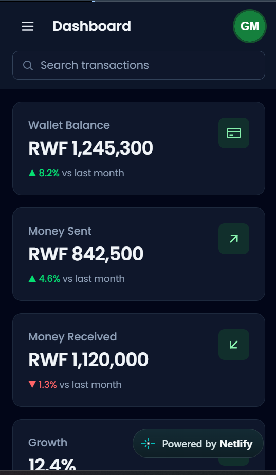
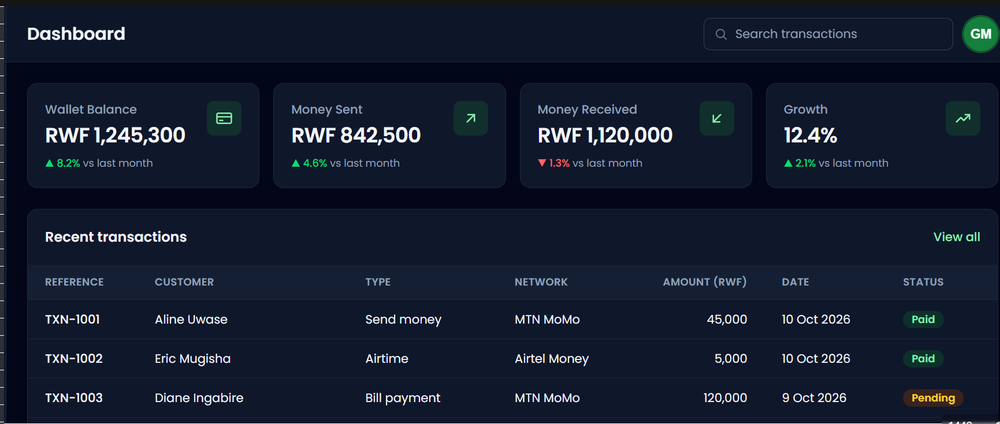

# PayWave Dashboard

**Live site:** https://chipper-custard-dffe7b.netlify.app/
**Repository:** https://github.com/Musekura20/week3-tailwind-dashboard

PayWave is a responsive admin dashboard for a fictional mobile money app. It is built with Tailwind CSS only (no custom CSS except the Tailwind entry file) and has a dark mode that needs no JavaScript.

## Screenshots

| Mobile (375px) | Desktop (1440px) |
| --- | --- |
|  |  |

## What is inside

- Sidebar with logo and 7 links with icons (hidden on mobile, always visible from `lg:`)
- Top bar with page title, search input and user avatar
- 4 stat cards: 1 column on mobile, 2 on `md:`, 4 on `xl:`
- Transactions table with colored status badges that scrolls sideways on small screens
- "Recent activity" and "Spending by category" panels
- "Send money" form with labels, a select and buttons
- Dark mode with the `dark:` variant (follows the device theme)

## How I customized Tailwind

I used Tailwind CSS version 4 with the official CLI. All my settings are in one file, `src/input.css`, which is my only CSS file.

First, I changed the theme. In the `@theme` block, I added a green color palette called `brand` (from `brand-50` to `brand-900`) and the Poppins font. Now I can use classes like `bg-brand-700` and `font-sans` anywhere in my page.

Then I made reusable classes with `@apply` inside `@layer components`. I made `.btn-primary` and `.btn-secondary` for buttons, `.card` for panels, `.badge` for status labels (Paid, Pending, Failed), `.nav-link` for the sidebar links, and `.input-field` for form inputs. This made my HTML shorter and kept the design the same everywhere.

For the bonus, I added dark mode with the `dark:` variant. It follows the theme of the user's device, so I did not need JavaScript. My mobile menu also uses no JavaScript. I used a hidden checkbox and Tailwind's `peer-checked:` variant.

## How to run it on your computer

First, install the packages and build the CSS:

```bash
npm install
npm run build   # makes dist/output.css
```

Then open `index.html` in your browser. While I work, I run `npm run build` so the CSS rebuilds every time I save.

## Project structure

```
index.html                  the page
src/input.css               Tailwind entry file (theme + components)
dist/output.css             built CSS (made by npm run build, not committed)
assets/avatar.svg           user avatar
screenshots/
  ├── mobile-375.png        mobile view of the page
  └── desktop-1440.png      desktop view of the page
README.md                   project description and live link
netlify.toml                Netlify build settings
package.json                project info and the build scripts
package-lock.json           exact versions of the installed packages
.gitignore                  ignores dist and node_modules
```
